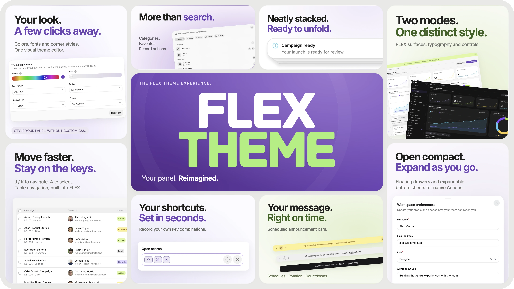
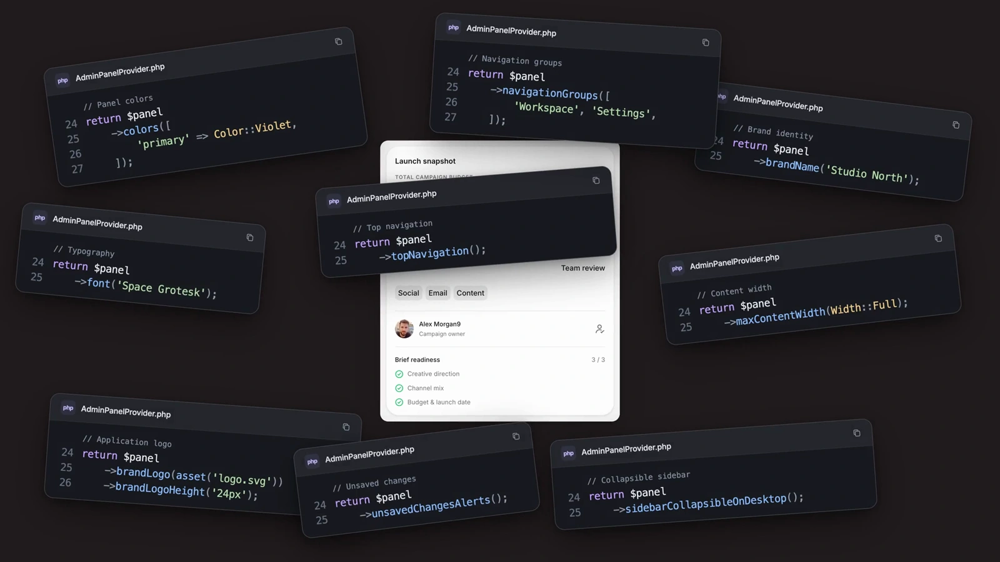
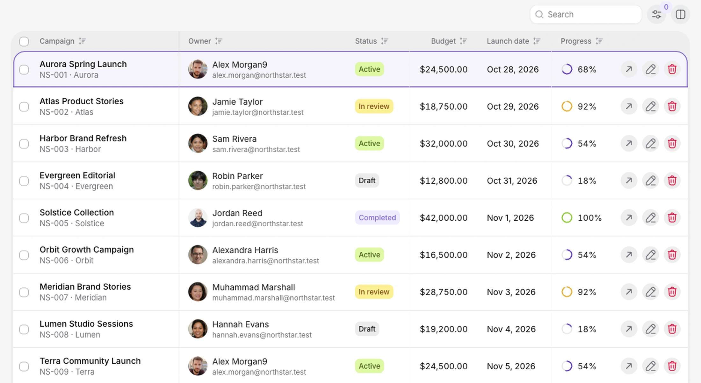
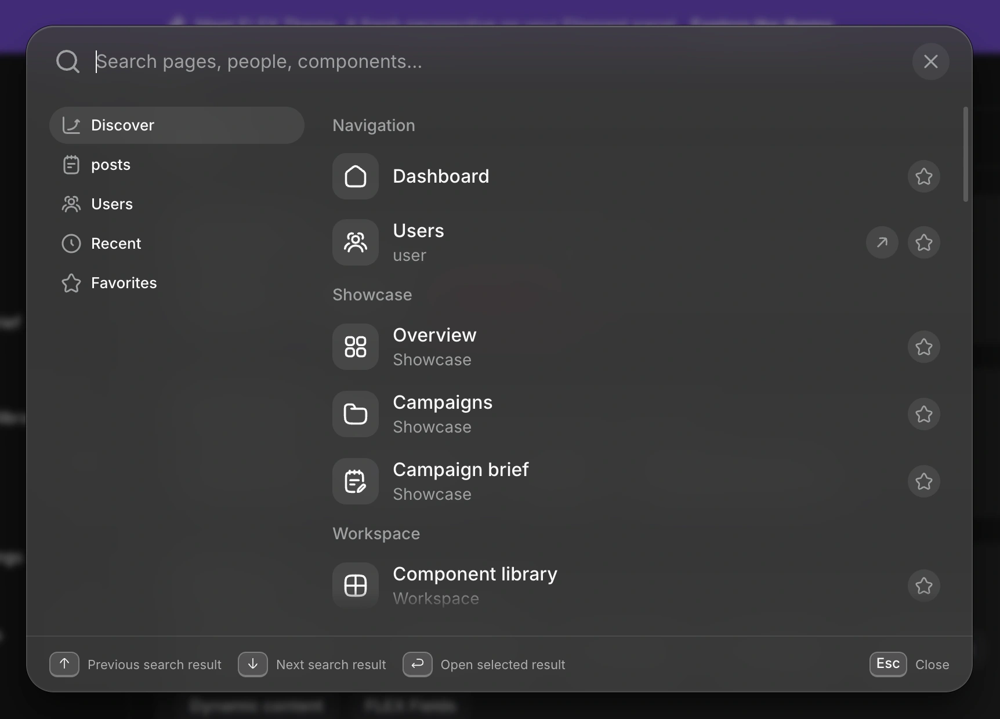
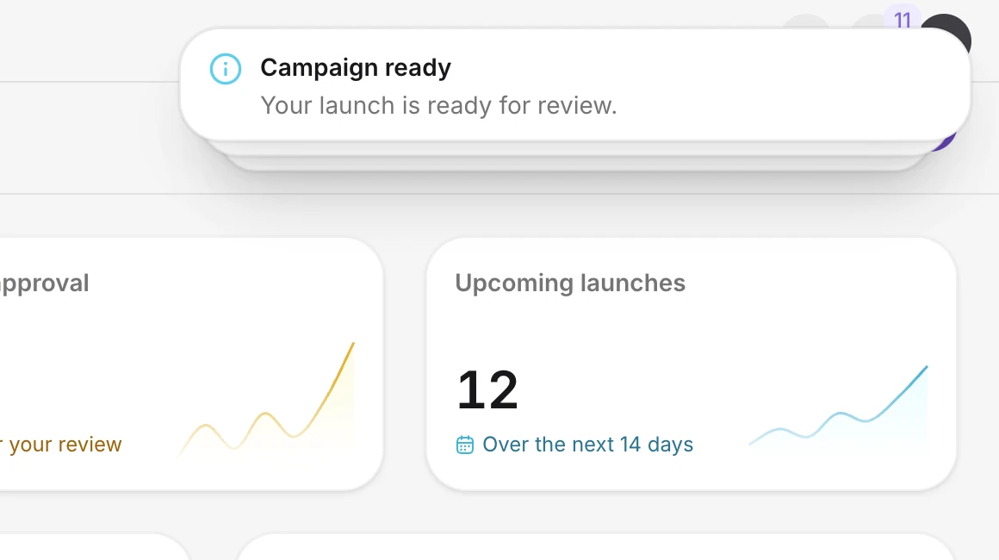

<h1 align="center">FLEX Theme for Filament 5<br>Your panel. Reimagined.</h1>

<p align="center">
  <strong>A premium Filament 5 theme with a visual editor and a faster way to work.</strong>
</p>

<p align="center">
  Give your Laravel admin panel a distinct identity with coordinated colors, typography and corner styles.<br>
  Find records and run actions from Global Search. Move through tables with the keyboard.<br>
  Bring the same attention to detail to notifications, announcement bars and floating panels.<br>
  Keep your native Filament resources, forms, actions and permissions.
</p>

<p align="center">
  <a href="https://shop.bjanczak.com/checkout/custom/88ee2f3a-e341-43d7-8b29-e47f0ca14862?signature=d472210ffbf92bd7ba06aea2a027192261775c6edad56b3d2594b8f29360f0d1"></a>&nbsp;
  <a href="https://flex-theme.bjanczak.com/docs/theme-settings/overview"></a>
</p>

<p align="center">
  <a href="#why-choose-flex-theme"><strong>Explore the features</strong></a> &nbsp;·&nbsp;
  <a href="#installation"><strong>Installation</strong></a> &nbsp;·&nbsp;
  <a href="#licensing"><strong>Licensing</strong></a>
</p>

<p align="center">
  <sub>One-time payment. No subscription. One year of updates included.</sub>
</p>

<p align="center">
  <a href="https://www.youtube.com/watch?v=POkDG3aMmgw">
    
  </a>
</p>

<p align="center">
  <a href="https://www.youtube.com/watch?v=POkDG3aMmgw"><strong>Watch FLEX Theme in action →</strong></a><br>
  <sub>See the real panel: style changes, keyboard shortcuts, search actions, notifications and floating panels.</sub>
</p>

## Why choose FLEX Theme?

Your admin panel is where people spend their working day. FLEX gives it a consistent visual language—and adds practical ways to get things done without leaving the task at hand.

| What FLEX adds | What it means for your application |
| --- | --- |
| **Your look. A few clicks away.** | A visual theme editor for colors, fonts, branding, corner styles and layout. Preview supported appearance changes before saving; enforce selected settings in PHP when needed. |
| **More than search.** | A search window for pages, records and commands, with categories, recent results, favorites and authorized record actions. Open an edit form or confirmation without navigating away from search. |
| **Move faster. Stay on the keys.** | Navigate native table rows, select records, change pages and open filters from the keyboard. Record custom shortcuts and discover available controls in contextual help. |
| **A place for every message.** | Styled notification stacks and configurable announcement bars for panel-wide news, scheduled messages, rotation and countdowns. |
| **Open compact. Expand as you go.** | Floating side panels and bottom sheets with configurable expansion heights. Native Filament Actions still own their forms, validation and submission. |
| **Your panel. Your rules.** | Saved preferences per panel, restricted settings access and selective or complete PHP configuration. Your existing application policies remain authoritative. |

FLEX styles native Filament components and adds the enhancements described here. It does not replace your application's models, queries or business logic. **FLEX Fields is a separate, optional product; it is not required or included.**

## See the experience

<table>
  <tr>
    <td width="50%" valign="top">
      <a href="https://flex-theme.bjanczak.com/docs/theme-settings/appearance"></a>
      <p><strong>Less custom CSS. More of your brand.</strong><br>Choose a coordinated palette, add a font and adjust panel and form-field corners independently.</p>
      <p><a href="https://flex-theme.bjanczak.com/docs/theme-settings/appearance">Explore the visual theme editor →</a></p>
    </td>
    <td width="50%" valign="top">
      <a href="https://flex-theme.bjanczak.com/docs/workspace/table-shortcuts"></a>
      <p><strong>Keep your hands on the keyboard.</strong><br>Move between records, select rows and open filters using configurable table shortcuts.</p>
      <p><a href="https://flex-theme.bjanczak.com/docs/workspace/table-shortcuts">Explore table shortcuts →</a></p>
    </td>
  </tr>
  <tr>
    <td width="50%" valign="top">
      <a href="https://flex-theme.bjanczak.com/docs/global-search/overview"></a>
      <p><strong>Find it. Act on it. Keep going.</strong><br>Search your panel and work with authorized records from one window, including native action forms.</p>
      <p><a href="https://flex-theme.bjanczak.com/docs/global-search/overview">Explore Global Search →</a></p>
    </td>
    <td width="50%" valign="top">
      <a href="https://www.youtube.com/watch?v=POkDG3aMmgw"></a>
      <p><strong>Stay informed. Keep your focus.</strong><br>Notifications collect into a compact stack and unfold when you need a closer look.</p>
      <p><a href="https://www.youtube.com/watch?v=POkDG3aMmgw">Watch the interface in action →</a></p>
    </td>
  </tr>
</table>

## A visual theme editor for Filament 5

What used to take code now takes a few clicks. Theme Settings brings supported design and workspace preferences into one administrator interface, so you can shape the panel without writing custom CSS for each component.

| Settings area | What you can configure |
| --- | --- |
| **Appearance** | Accent and Base tint, font family, custom Google Fonts, independent panel/form corner scales, and available light/dark modes. |
| **Colors** | Primary, success, warning, danger, info and gray palettes, with light and dark component previews. |
| **Brand** | Workspace name, expanded and compact logos for light/dark mode, and favicons. |
| **Layout** | Classic or Inset frame; Sidebar, Topbar or Sidebar + topbar navigation; collapse behavior, breadcrumbs, user-menu position, content width and spacing. |
| **Details** | Text size, motion, label case and the theme-switch transition. |
| **Search** | Search presentation, category navigation, history, favorites and result delivery options. |
| **Keyboard** | Shortcut recording, platform-specific keycaps and the shortcut reference. |

Preview supported appearance changes, then **Save changes** to apply the configuration. Import and export portable preferences as JSON, review differences before applying an import, or reset one preference tab. PHP-managed values stay locked throughout these operations.

Settings are shared by the current panel, rather than stored separately for every user or tenant. Give each panel its own design and restrict administration through the `manage-flex-theme` gate. You can hide the entire settings page, hide individual feature tabs, enforce selected values or configure the theme completely in PHP.

[Theme Settings overview](https://flex-theme.bjanczak.com/docs/theme-settings/overview) · [PHP configuration](https://flex-theme.bjanczak.com/docs/theme-settings/configuration) · [Panels and permissions](https://flex-theme.bjanczak.com/docs/theme-settings/panels-permissions) · [Complete settings reference](https://flex-theme.bjanczak.com/docs/theme-settings/reference)

## Global Search that goes beyond navigation

FLEX discovers registered, accessible pages and searchable resources from your existing panel. Keep native searchable attributes, record titles, query scopes and policies; add a focused search experience around them.

- **Narrow the search:** choose a resource category, search its records and return to recent results or favorites.
- **Work with the result:** expose permitted view, edit, create or delete actions, with native forms and confirmations where configured.
- **Add useful commands:** open a permitted settings page, change the appearance or run your own authorized application command.
- **Connect more of your app:** add paged custom sources, filters, nested contexts or authorized cross-panel and tenant navigation.

Search actions recheck access when invoked. Your application remains responsible for record scopes and permissions. Disabling FLEX Search restores native Filament search; native `globalSearch(false)` is respected unless you explicitly enable commands-only discovery.

[Get started with Global Search](https://flex-theme.bjanczak.com/docs/global-search/quickstart) · [Record actions](https://flex-theme.bjanczak.com/docs/global-search/actions) · [Custom sources](https://flex-theme.bjanczak.com/docs/global-search/sources) · [Permissions](https://flex-theme.bjanczak.com/docs/global-search/permissions)

## Keyboard shortcuts for everyday work

Move through rendered native table rows with **J / K**, toggle a row's selection with **A**, open it with **O**, and open filters with **F**. Use **Command / Control + A** to select the current rendered page. These defaults can be changed or disabled; they do not select your entire database.

Record your own bindings in Theme Settings or enforce them in PHP. Contextual help shows the controls available for the current table or workspace. Text inputs and editors keep their normal typing, text selection and Undo behavior.

For workflows that need a second chance, optional **recovery** can undo eligible configured native actions. Declare supported models, columns and policies first; delete/restore recovery requires soft deletes. It does not make arbitrary operations reversible.

[Shortcut recording and commands](https://flex-theme.bjanczak.com/docs/workspace/keyboard) · [Table navigation and selection](https://flex-theme.bjanczak.com/docs/workspace/table-shortcuts) · [Optional action recovery](https://flex-theme.bjanczak.com/docs/workspace/recovery)

## Announcement bars, where the message belongs

Publish release news, maintenance notices or a countdown across the panel—or place a bar within a page. Configure message colors, icons, links, rotation, playback controls, schedules and dismissal behavior in PHP. Authorized live providers can deliver updates when your application needs them.

Announcement bars are separate from native toast notifications. They are code-configured; FLEX does not add an announcement content-management interface to Theme Settings.

[Announcement bars](https://flex-theme.bjanczak.com/docs/announcements/overview) · [Configuration](https://flex-theme.bjanczak.com/docs/announcements/configuration) · [Recipes](https://flex-theme.bjanczak.com/docs/announcements/recipes) · [Live updates](https://flex-theme.bjanczak.com/docs/announcements/live-updates)

## Floating panels and expandable bottom sheets

Give a native Filament Action a floating side panel or a bottom sheet. Open compact, then expand to configured heights through the grabber, keyboard or supported scrolling interaction. Short content stays compact; longer forms can scroll within the sheet.

Your existing Action keeps its schema, validation, authorization, submit controls and modal lifecycle. FLEX changes the presentation and adds sheet expansion behavior.

For settings forms, **FieldGroup** aligns labels and descriptions beside native controls and stacks them on narrow containers. It uses your theme's typography, surfaces and corner styles while retaining native field state and validation.

[Bottom sheets and floating drawers](https://flex-theme.bjanczak.com/docs/components/bottom-sheet) · [Field groups](https://flex-theme.bjanczak.com/docs/components/field-groups)

## Installation

Use an existing **Filament 5** application with **PHP 8.3+**, a native theme build and a purchased FLEX Theme license. The package is currently verified against Filament **5.10.2**; check your application's own components and plugins before production use.

**1. Install through the protected Composer repository.**

```bash
composer config repositories.flex-theme composer https://license.bjanczak.com/v1/flex-theme/composer/
composer config --auth http-basic.license.bjanczak.com license YOUR_LEMON_LICENSE_KEY
composer require flex/theme:^0.1
```

Replace the placeholder with your purchased key. Keep Composer authentication out of version control and public logs; use your CI secret manager for automated builds. You do not need a GitHub token or access to the private repository.

**2. Register FLEX in your panel provider.**

```php
use Flex\Theme\FlexThemePlugin;

return $panel
    ->plugin(FlexThemePlugin::make())
    ->viteTheme('resources/css/filament/admin/theme.css');
```

If your panel does not have a theme yet, generate one with `php artisan make:filament-theme admin`. Keep the generated native imports and add:

```css
@import '../../../../vendor/flex/theme/resources/css/theme.css';
@source '../../../../vendor/flex/theme/src/**/*.php';
@source '../../../../vendor/flex/theme/resources/views/**/*.blade.php';
```

**3. Publish assets, migrate and build your application's theme.**

```bash
php artisan vendor:publish --tag=flex-theme-source --force
php artisan migrate
npm run build
```

The package includes built runtime JavaScript; normal installation does not require building its internal JavaScript. Republish assets and rebuild your application's theme after upgrades. Configure Laravel's public disk and storage link if you use uploaded branding files.

**4. Authorize theme administration.**

Define the `manage-flex-theme` Laravel gate for the people allowed to change the panel's design. Ordinary panel users do not need this permission to see the saved theme.

[Complete installation and settings guide](https://flex-theme.bjanczak.com/docs/theme-settings/overview#installation) · [Access control](https://flex-theme.bjanczak.com/docs/theme-settings/panels-permissions)

### Keep selected settings in PHP

Let administrators edit the theme while locking the preferences you control in code:

```php
FlexThemePlugin::make()->settingsOverrides([
    'accent' => '#7046b6',
    'radius_scale' => 'medium',
    'form_radius_scale' => 'large',
]);
```

Use `settingsPage(false)` to hide the settings interface while retaining saved preferences. Use `settings([...])` for a fully PHP-managed theme; this also removes the settings page. Register a separate plugin instance in each panel provider for independent panel configurations.

[Configuration precedence, feature switches and examples →](https://flex-theme.bjanczak.com/docs/theme-settings/configuration)

## Licensing

**Pay once. No subscription. One year of updates included.**

Both plans include the complete FLEX Theme package. Keep using the versions covered by your purchase after the update period ends; renew only if you want access to newer releases.

| | Single | Unlimited |
| --- | --- | --- |
| Payment | One-time | One-time |
| Production scope | One application at one hostname | Unlimited applications and hostnames owned and operated by one license holder |
| Features | Complete package | Complete package |
| Updates released during the included period | One year | One year |
| Continued use of eligible versions | Included | Included |
| Private development, staging and CI for licensed applications | Included | Included |
| Separate developer or end-user seat charge | None | None |

Unlimited is not a reseller license for independently owned client applications. Those applications need their owner's license. The checkout lists current prices, taxes and the selected variant. The binding terms are in [LICENSE](LICENSE); [COMMERCIAL.md](COMMERCIAL.md) explains domain allowances, client projects and update rights.

[**Buy FLEX Theme →**](https://shop.bjanczak.com/checkout/custom/88ee2f3a-e341-43d7-8b29-e47f0ca14862?signature=d472210ffbf92bd7ba06aea2a027192261775c6edad56b3d2594b8f29360f0d1)

## Documentation and support

Find configuration guides, PHP examples and complete references at **[flex-theme.bjanczak.com](https://flex-theme.bjanczak.com/)**.

[Theme Settings](https://flex-theme.bjanczak.com/docs/theme-settings/overview) · [Global Search](https://flex-theme.bjanczak.com/docs/global-search/overview) · [Announcements](https://flex-theme.bjanczak.com/docs/announcements/overview) · [Keyboard and tables](https://flex-theme.bjanczak.com/docs/workspace/table-shortcuts) · [Floating panels](https://flex-theme.bjanczak.com/docs/components/bottom-sheet)

For reproducible bugs, [open an issue](https://github.com/janczakb/filament-flex-theme/issues) with your versions and reproduction steps. Never include license keys, credentials or private application data. For licensing questions, contact [barek122@gmail.com](mailto:barek122@gmail.com). General support and an SLA are included only when expressly agreed.

This public repository contains product documentation, previews and legal information. Paid package implementation and releases are delivered through the protected Composer service. There is no free edition or open-source grant. Keep your own permitted package copies and deployment backups; future releases and indefinite hosted-service availability are not guaranteed.

## License

Copyright © 2026 Bartłomiej Janczak. All rights reserved. Proprietary commercial license. See [LICENSE](LICENSE), [COMMERCIAL.md](COMMERCIAL.md) and [THIRD_PARTY_NOTICES.md](THIRD_PARTY_NOTICES.md).
